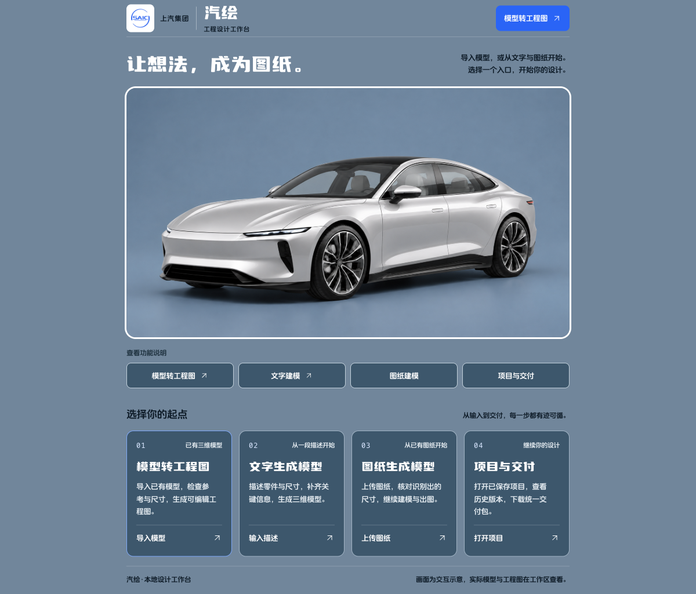
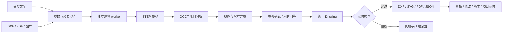

<div align="center">

# 汽绘 DrawForm

### 从三维模型，到可继续编辑的工程图

**STEP → 几何分析 → 尺寸与参考确认 → DXF · SVG · PDF · JSON**

[](drawform/pyproject.toml)
[](drawform/frontend/package.json)
[](drawform/frontend/src)
[](drawform/src/drawform/geometry)
[](docs/PUBLIC_RELEASE.md)

[快速开始](#快速开始) · [功能与边界](#功能与边界) · [技术架构](#技术架构) · [验证记录](docs/PUBLIC_RELEASE.md) · [开发文档](docs/README.md)

</div>



> 首页汽车与剖面是交互示意素材。零件的真实几何、尺寸、模型版本与交付文件在工作区中查看。

## 为什么做 DrawForm

三维模型表达零件的形状，工程图还要表达尺寸、基准、公差与制造要求。DrawForm 将可计算的几何与出图过程串起来，把缺少依据的工程决定交还给人，并保留确认、修改和交付的记录。

当前聚焦**简单单零件**。核心路径是 STEP 自动出图；文字和图纸建模支持明确约束的板件、圆盘、垫圈及二段实心阶梯轴。输入不明确时先澄清，检查不通过时阻止交付。

**2026-10-21 发布检查：** 开发机完整回归 **1,708 项通过**，公开快照基础回归 **39 项通过**，前端测试、参考校验与构建通过。两组回归的环境和数据范围见[验证说明](docs/PUBLIC_RELEASE.md)。

## 功能与边界

| 工作入口 | 当前能力 | 适用边界 |
| --- | --- | --- |
| **3D 转 2D** | STEP 读取、三视图、显式剖切、中心线、尺寸方案、图框及四种输出 | 简单单实体；自动选视图与自动选剖切位置尚未完成 |
| **文字建模** | 有限文字语法、缺失尺寸澄清、参数修改、原生 STEP 和二维出图 | 受控零件族；任意自然语言建模尚未完成 |
| **图纸建模** | DXF 原生几何与尺寸读取；PDF/图片本地识字、角色标注和必要澄清 | 简单单视图及明确角色；PDF/图片识别依赖 macOS |
| **项目与交付** | 有效版本、显式发布、交付包、来源校验、审计及工作区恢复 | 技术采用与工程审图是不同状态 |

### 让结果可以核对、继续修改

- **可编辑尺寸**：DXF 输出原生 `DIMENSION` 实体，支持在 CAD 中继续处理。
- **统一图纸数据**：DXF、SVG、PDF 共用 `output/drawing.py`，减少各出口之间的几何漂移。
- **交付检查**：检查实体、尺寸方案、落位、图幅和尺寸测量一致性；阻断时给出原因。
- **人在回路中**：问题卡、封闭候选、参考确认、公差回答及回写均保留来源。
- **版本可追溯**：机器底稿、人工修改、生效版本和交付包形成可核对的记录链。

<details>
<summary>查看实际生成的工程图：五孔板合成示例</summary>


本次发布检查程序化构造 80 × 80 × 12 mm 板件、5 × ⌀9 通孔与 ⌀50 分布圆，经公开快照的 `render_part` 实际生成四种输出。图中仍注明“未经制图审核”；默认基准与一般公差不代表已确认全部工程意图。它是演示几何，没有使用实际业务图纸。

</details>

**工程验收仍需人完成。** 当前没有完成集团真实件人工制图验收；完整形位公差框格、粗糙度输出、通用设计基准推断、装配图、钣金展开与焊接图不属于已完成能力。DXF/SVG/PDF/JSON 是当前主要出口，DWG 的现场验证见历史记录，不能据此承诺普遍兼容。

## 快速开始

建议使用 **Python 3.12、Node.js 22+、pnpm 10.15.1**。几何服务与建模 worker 使用不同 OCCT 版本，分别安装环境。

### 1. 安装几何服务

```bash
git clone https://github.com/26YZT/drawform.git
cd drawform

python3.12 -m venv .venv
.venv/bin/python -m pip install -e './drawform[dev]'
```

### 2. 构建首页

```bash
cd drawform/frontend
corepack pnpm install --frozen-lockfile
corepack pnpm build
cd ../..
```

如果环境没有 Corepack，可用 `npx --yes pnpm@10.15.1` 替换 `corepack pnpm`。Vite 单独启动只预览首页；业务流程由下面的 Flask 同源服务承载。

### 3. 启动本机服务

```bash
export DRAWFORM_FRONTEND_DIST="$PWD/drawform/frontend/dist"
export DRAWFORM_TOKEN="local=$(.venv/bin/python -c 'import secrets; print(secrets.token_urlsafe(32))')"

.venv/bin/python -m drawform.service --port 8000 --work .local/work
```

访问 **http://127.0.0.1:8000/**。工作区要求填写令牌，使用上面环境变量中 `local=` 后的值；在本机终端查看并自行保存，不要提交到仓库。服务默认只监听本机，正式部署另见[部署说明](drawform/deploy/README.md)。

### 4. 启用文字 / 图纸建模

```bash
python3.12 -m venv runtimes/cadgen_bridge/.venv
runtimes/cadgen_bridge/.venv/bin/python -m pip install \
  --require-hashes -r runtimes/cadgen_bridge/requirements.lock
```

建模 worker 使用独立的 **OCCT 7.9** 环境，几何出图服务使用 **OCCT 8**；不要将它们装进同一个虚拟环境。服务默认寻找上述 worker 路径，也可通过 `DRAWFORM_MODEL_PYTHON` 指定。PDF/PNG/JPEG 输入还需要 macOS 的 Xcode Command Line Tools，由本地 Vision/PDFKit 完成识别；详见[建模运行时](runtimes/cadgen_bridge/README.md)与[图纸输入](runtimes/drawing_bridge/README.md)。

## 技术架构



| 层 | 主要实现 |
| --- | --- |
| 几何与标注 | Python · OCCT · ezdxf · NumPy |
| 数据与服务 | Pydantic · Flask · 本地持久化与审计 |
| 首页与工作区 | React · TypeScript · Vite；工作区由 Python 服务提供 |
| 受控建模 | 独立 Python worker · cadgen · build123d |
| PDF / 图片输入 | macOS Vision · PDFKit · Swift |

## 检查与测试

公开仓库自带合成测试夹具和注明来源的 NIST 回归件。下面这组基础回归无需外部语料或建模环境：

```bash
.venv/bin/python -m pytest \
  drawform/tests/test_pipeline.py \
  drawform/tests/test_output_dxf.py \
  drawform/tests/test_service_auth.py \
  drawform/tests/test_claude_audit_regressions.py \
  -k 'not corpus_coverage' -q

cd drawform/frontend
corepack pnpm test
corepack pnpm verify:adaptation
corepack pnpm build
```

完整开发回归的命令为 `.venv/bin/python -m pytest drawform/tests/ -q`，另需按各测试要求准备外部语料、本地工具与隔离建模运行时。**公开克隆不携带这些数据和已安装环境**；跳过或缺少夹具不能当作完整验证通过。[本次发布检查及复现范围](docs/PUBLIC_RELEASE.md)单独记录。

## 项目导航

```text
drawform/
├── src/drawform/
│   ├── geometry/       STEP、投影、特征、剖切与参考
│   ├── dimensioning/   尺寸方案、约束、落位与一般公差
│   ├── output/         统一图纸数据与多格式输出
│   ├── rules/          公差数表、标注语法与规则
│   ├── service/        任务、问题卡、回答、复核与审计
│   └── workbench/      输入澄清、建模、项目与恢复
├── frontend/           React 首页、交互素材与来源说明
├── tests/              单元、集成、几何及回归测试
└── deploy/             本地部署、运维与验证工具
runtimes/               隔离建模与 macOS 图纸输入桥接
research/               量测和回归脚本
docs/                   设计、契约、验证与历史状态
SOURCE_SNAPSHOT.json    本次公开源码的 SHA-256 清单
```

优先阅读[公开发布说明](docs/PUBLIC_RELEASE.md)、[当前实现与历史验证](docs/README.md)、[10 月 21 日修复记录](docs/validation/DrawForm-审查复核与缺陷修复-20261021.md)。历史文档中的 PID、端口、绝对路径和统计数字只对应当时的本机环境；PRD 是历史规划，不代表已实现能力。

## 来源与许可

首页基于 Amir Mušić 的 [VEYRA v1.0.0](https://github.com/amirmushichge/veyra-interactive-car/tree/v1.0.0) 适配，保留原 MIT 许可及媒体来源；字体与 Canvas UI 组件遵循各自条款。品牌标志不表示相关机构背书。详细范围见[第三方声明](THIRD_PARTY_NOTICES.md)。

这是最新开发版本的公开源码快照，不含工程任务数据、内部图纸、令牌、证书、下载语料、虚拟环境及旧版工作目录。项目原创代码尚未另行指定统一开源许可证，第三方内容继续适用原有许可。
