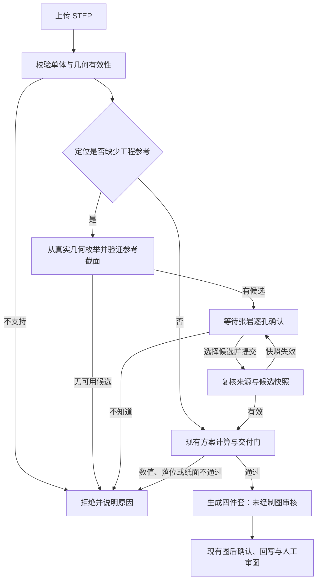

# 斜孔图前参考确认流程：V1 批准方案

> **当前实现核对（2026-10-15，V1）：** [实现与验证](../validation/P0-斜孔图前参考V1实现与验证-20261015.md)：**1048 passed +1 xfailed(strict)**，新增70项；仅扩展单独获批的CTC01函数与旋转盲孔深度函数2个案例，其余106个保护条目保持。V1已接入本机HTTPS；公开15件5出图/8拒绝/2待参考确认/0崩溃，75个原生尺寸值保持。历史120条任务/156份图件保留，另2条公开待确认，总122条；真实件登记/人审均0，P0.4/T-30未签。

日期：2026-10-15。用户先授权设计，再明确回复“批准V1（含明确标识的延拓平面）”。以下范围已获准进入实现；原978图框报告保持封存；当前V1已接入本机HTTPS，1048项通过、70项新测试。文件名保留原审阅入口，具体孔的参考仍须张岩选择。

## 批准范围

V1在计算斜孔定位值之前，由张岩从 STEP 中可验证的平面参考里选择一个截面。系统用该截面与孔轴的交点计算定位值，随后仍走原有数值、落位和纸面交付门。

参考确认不等于制图验收。没有候选、选择“不知道”、交点不可信或图面仍放不下时，都不能出图。方案不会自动拆装配体、读取 PMI 标注、添加任意截面坐标或生成辅助视图。

用户已批准把STEP中真实平面面片的延拓平面作为明确标识的参考截面候选。V1展示其来源与有限面片关系，由工程师逐项确认；系统不默认勾选、不把它叫作实际孔口。

批准延拓候选仍不保证四件NIST出图：当前CTC01/CTC04等待参考确认，CTC02没有稳定候选，FTC06保留A3纸面拒绝。具体工程参考与后续交付门分别判断。

## 为什么需要这一步

NIST CTC01 的一个直径10 mm斜孔，保持孔轴、有限段两端及原始 STEP 不变，仅把轴上任意一点沿轴移动10 mm，当前方案的 Y 定位值就由288.50850269变成283.50850269 mm。

这不是模型变形。`Bore.axis_point` 表示轴线上可任取的一点，不能直接充当工程定位点。现有有限段检查和数值一致性交付门不能补足工程参考含义。反例与重新提取后的复核见[诊断记录](../validation/P0-斜孔定位参考与继续开发决策-20261015.md)。

批准前服务只在 `drawn` 状态开放图后问题卡，`refused` 状态返回409。当前V1在定位计算前开放独立参考确认；图后问题卡仍只服务已出图对象。

## 用户会经历什么

1. 普通正交孔继续原流程。只有拟计算的定位坐标沿孔轴变化、缺少唯一参考点时，才进入图前确认；不能继续用方向分量“小于0.5”作为正交依据。
2. 等待确认时，几何 worker 释放，其他任务继续串行处理；不持续占用计算线程。
3. 用户查看目标孔、候选截面和交点关系，逐孔选择。相同直径或方向不代表可以自动共用参考。
4. 提交后，系统从同一 STEP 重新验证参考，再计算尺寸。确认成功只解决参考定义，其他交付门继续执行。
5. 出图后保留“未经制图审核”。实际采纳与审图耗时仍须人工记录。

## 确认页内容与操作

沿用现有任务详情页与问题卡，不重做全站视觉。下列图前交互已实现并作页面演练，证据见当前验证报告。

| 区域 | 用户看到什么 | 操作与限制 |
|---|---|---|
| 顶部状态 | “需要先确认斜孔参考”；图前确认项数 | 目标孔可核对；没有“已出图”或交付下载按钮 |
| 目标孔 | 源几何投影、孔轴、目标孔边界；直径由引擎给出 | 高亮目标；不能拖动孔轴、录入坐标或把预览当加工图 |
| 候选参考 | 来源平面高亮、参考截面与交点；“面片上交点”或“仅延拓平面交点” | 单选且初始不选；候选编号仅供展示，内部身份不用序号 |
| 确认摘要 | 本次孔、所选参考、受影响的定位方向与原因 | 可返回修改；说明不能确认时不会出图 |
| 主操作 | “确认参考并计算图纸” | 请求中显示提交状态；重复点击不重复出图 |
| 其他操作 | “我不知道，应交给工程师处理”；返回任务列表 | 不知道作为显式答案记录，结果拒绝，不取中点或默认候选 |
| 异常 | 来源已变、候选已失效、几何核验失败等具体原因 | 保留可解释信息；重新加载后必须再次明确选择 |

预览只显示源几何和只读参考关系，不显示尚未确认的定位数值，不产生 DXF/PDF 加工图。仅靠颜色不能区分目标孔和参考面，须有文字与线型标识；候选控件可键盘操作，错误提示关联到对应问题。刷新后恢复服务器已保存的状态；浏览器中尚未提交的选择不能显示为已确认。

## 哪些参考可以成为候选

首版只处理可唯一识别的单孔轴定位。非平面曲面孔口、任意构造截面、斜孔分布圆以及需要新辅助视图的情况继续拒绝，保留全部约束，不降级成少画尺寸。

每个候选同时满足：

- 平面来自输入 STEP 的实际平面面片，保留面边界与来源指纹；不凭外包围盒、孔轴端点或中点造平面。
- 孔轴与平面不平行，即平面法向与孔轴方向的点积 `n·d` 不能接近0，交点才可唯一、稳定地计算；法向平行孔轴是稳定的垂直截面，不排除。孔轴近乎平行平面或数值不稳定时排除，并列明原因。
- 交点落在该孔经几何验证的有限轴向范围内；超出范围的平面排除。
- 验证交点是否落在实际有限面片上；否则明确标为“延拓平面参考”，不声称它是孔口。
- 不把柱面交线 B 样条的端点、包围盒极值或人为向量冒充可确认参考。

平面参考定义确定的是“在何处取孔轴上的点”，定位尺寸仍按当前被确认的基准体系计算。即使平面来源真实，选它作为工程参考的意图仍须张岩判断。

用孔轴 `P + t d` 与平面 `n·X = k` 求交得到 `Q`，定位坐标由 `Q` 和既有基准原点计算。`P` 沿轴替换、轴方向反转或平面参数原点改变，不应改变 `Q` 和最终定位值。不得把仅用于轴线身份的最近原点点，直接当作加工定位点。

数值阈值采用现有几何公差规则及 OCCT 实际公差；实现时须用近乎平行、边界和退化案例验证，不在本提案凭空添加容差数表。

## 几何身份与失效规则

| 对象 | 身份依据 | 必须拒绝的情况 |
|---|---|---|
| 输入 | 原始 STEP SHA-256 | 文件已变或输入不可读 |
| 孔轴 | 规范方向、轴线垂距、半径、有限段真实两端 | 两对象指纹碰撞、身份歧义；不得只按同径同向合并 |
| 平面面片 | 规范法向、平面常数、面积/质心与真实边界 | 仅编号相同、几何身份不一致 |
| 候选集 | 输入指纹、引擎依据版本、目标孔与完整候选内容的摘要 | 截断后冒充完整清单、旧候选被再次提交 |
| 已选参考 | 问题ID与候选ID，绑定上述快照 | 自由数值、自由向量、陌生候选或其他文件的候选 |

当前 `Bore.axis_span` 是沿规范方向的全局投影坐标，不是相对 `axis_point` 的参数。孔轴用垂距点与规范单位方向重建有限两端；仅沿轴替换 `axis_point` 时保持全局 `axis_span` 不变，身份也必须不变。不能直接把可任取轴点或未经规范的参数当身份。候选排序可改变显示序号，不能改变选择指向。规范化量化发生碰撞时拒绝，不悄悄合并。

首版若候选数量超过现有64项上限，返回明确拒绝与候选过多原因；不截取前64项后让用户误以为是完整范围。没有候选时给出拒绝依据，不制造空问题卡。

## 状态与接口（已实现）

以下契约已接入代码并验证。现有图后 `/questions`、`/answers` 契约继续服务原三类问题。

| 状态/事件 | 当前行为 |
|---|---|
| `queued → running` | 沿用单 worker 执行 |
| `running → waiting_reference` | 持久化可重建依据与候选；此时没有交付文件 |
| 等待态重启 | 重新载入并复核快照；有效时恢复等待，失效时说明需重新确认 |
| 提交有效完整选择 | 原子保存确认记录，进入 `queued → running`，同一时间仅一个有效计算请求 |
| 显式“不知道” | `refused`，原因 `reference_unconfirmed`；后续有依据时重新提交 STEP |
| 无候选/退化 | `refused`，带具体几何原因；不改成通用崩溃 |
| 重新计算后的其他门失败 | 保留原有失败项，例如 `unplaced_dimensions`、`sheet_overflow` |
| 交付门通过 | `drawn`；此后进入原有图后流程 |

等待任务计入在册任务数量，沿用已批准的人工留存政策，不自动删除。只读核对发现，`test_confirmed_retention.py` 明确保护超过200条任务仍保留，现有 `service/retention.py` 也仅提示核查；早期提案的“200条上限”表述据此纠正，不增加自动清理。人工移除后按现有任务不存在规则返回404，需重新提交。等待态、拒绝态都不计入出图成功或人工采纳数。

现有两个实际用途明确的端点，避免把“可下载加工图”和“可确认源几何”混成一个状态：

- `GET /jobs/{id}/reference-questions`：只读返回来源快照、目标孔、非空候选与只读预览；等待态可读，其他状态按契约返回409。
- `POST /jobs/{id}/reference-answers`：只接收来源快照摘要、`question_id`、`option_id` 或显式 `null`，以及有限长度的备注。陌生字段，包括坐标、数值、方向向量，返回400。

来源与候选已失效、并发冲突返回409，任务不存在返回404。相同有效提交返回已有计算请求，不重复排队；不同答案不能静默覆盖已排队的选择。确认记录保存既有认证身份与操作者显示名、时间、来源、候选快照和结果；显示名不冒充身份认证或审图签字。

后续图后答案回写仍调用唯一 `pipeline.render_part`，必须带上已验证的参考快照并重新核对；不能回到任意轴上点计算，也不能将旧参考自动套到换过的 STEP 上。已经出图后若要另选图前参考，首版要求重新提交，避免引入第二套图后参考版本编辑。

## 技术验证与实际工程判断

| 检查 | 必须观察到的结果 |
|---|---|
| 等价几何反例 | 轴点沿轴移动、方向反转、拓扑枚举顺序改变后，选中同一几何参考的定位值一致 |
| 候选可信度 | 近乎平行、交点越界、无平面、指纹碰撞均可解释地拒绝；延拓参考正确标识 |
| 数值唯一来源 | 手输 `value`、坐标、向量及陌生ID不能进入尺寸；备注不参与计算 |
| 不知道/未提交 | 不产生交付图；不自动选第一项或使用零值 |
| 持久化与冲突 | 新进程恢复等待、重复提交仅一次计算、过期快照拒绝、跨文件选择拒绝 |
| 现有工作流 | 普通已支持样本仍走原流程；图后回写保留同一参考；各出口与原交付门一致 |
| 统计与留存 | 等待/拒绝不记为成功或人审；超过200条仍保留、人工移除后的404路径可验证 |
| 实际工程判断 | 张岩确认参考含义并审核生成图；机器检查不能替代这一项 |

本批实际改动范围为特征/方案/落位、单一流水线、任务持久化、图前端点与对应任务页。若任何旧测试与新规格冲突，先列出精确差异；**图框3项授权未被泛化**；用户另逐项批准CTC01单函数与旋转盲孔深度单函数2个案例扩展，原断言保留，其他旧测试不改。GEO-019 strict xfail继续保留。

## 依据与设计取舍

Refero 在线流程检索返回 `NO_SUBSCRIPTION`，未取得在线参考，不声称审阅过其他产品流程。按技能的离线回退方式，使用其自带 `craft-details.md` 的表单错误关联、提交状态、键盘操作、刷新/导航状态规则，并以当前产品作为主要交互参考。本批沿用既有任务页，在问题区补充图前卡片、源几何预览、键盘选择与等待/拒绝状态；没有视觉改版。

| 决策 | 依据 | 取舍 |
|---|---|---|
| 确认前移到定位计算前 | 当前源码、5 mm反例、用户要求先设计 | 避免参考未定的值进入底稿 |
| 保留原任务详情和闭合候选 | 当前P0确认约束、现有问题卡 | 不增加自由数值入口 |
| 候选需来源和关系说明 | STEP拓扑诊断、真实工程参考尚未确认 | 延拓平面与实际孔口分开表达 |
| 无默认选择、允许不知道 | 用户既有约束、现有 `Question.allow_unknown` | 无依据时维持拒绝 |
| 明确提交中、错误与恢复路径 | Refero离线表单/状态规范 | 重复提交、过期依据和未保存选择可解释 |
| 图前确认与制图审核分别记录 | 真实件登记/人审当前均0、既有试点纪律 | 不把选择参考计为人工采纳 |

本批已按批准范围实现。范围批准不表示批准某一孔的具体参考，也不构成真实件验收或生产放行。

## V1当前图面与回传约定

已确认孔用H编号、参考面用R编号；平面方程采用当前A/B/C坐标面交点为原点，STEP正向和占位状态在图上写明。相同平面共享方程，显示归零须满足全部相关孔的最严格几何公差。真实交点以独立NOTE引注，原生尺寸文本保持。人工CAD回传保护关键参考实体及其层/字体/显示打印属性；改参考须重新提交STEP。技术证据见[本批记录](../validation/P0-斜孔图前参考V1实现与验证-20261015.md)，实际张岩制图判断仍待执行。
