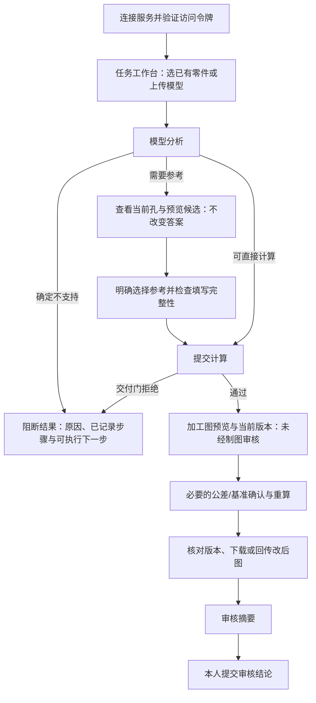

# P0 前端交互流程审查

日期：2026-10-15。范围：从首次访问、连接服务、找到任务、选择参考，到生成结果、查看版本、回传及审核。本轮只审查，未修改产品源码或既有测试，未提交真实上传、工程参考或审核结论。

主要问题集中在前置条件、查看与确认的顺序、提交与恢复、审核结论的表达。页面把多个不同阶段放在同一侧栏，用户必须自己判断当前应做哪一步；其中还存在会清空选择、静默改变审核意见的具体代码行为。建议先修这两类行为，再调整完整任务流程。

## 证据与边界

- 用户截图：未连接时仍以“上传STEP，开始审图”为主入口，访问令牌藏在侧栏任务区。
- Safari当前页面：已连接后显示122条任务，列表只有任务编号、状态与技术错误码；用户原页面有已选文件。本轮通过复制标签页观察新会话，结束后关闭复制页，原文件选择和已连接页面保持。
- 真实只读API与任务记录：CTC01 `3f61b37c17b9` 已有1次、4项参考提交，结果为 `sheet_overflow`，没有交付图；CTC04 `1dbc376bb152` 仍待16孔确认，74个候选，加16个“不知道”，共90个单选项。实际审核结论仍0。
- 源码：`service/app.py` 的页面、事件、状态路由；相关参考校验及审核记录代码。
- 7个隔离逻辑场景：直接截取当前前端函数，在Node VM中用最小DOM/API替身执行。覆盖400及网络失败清选择、勾选A类问题后直接用、413误报、16/16但缺姓名、一个不知道仍须补齐16项、切任务清草稿。**这些不是完整浏览器端到端测试，也没有调用真实提交接口。**
- Refero流程/页面检索均返回 `NO_SUBSCRIPTION`；未取得在线产品案例。审查依据为当前产品、用户截图和Refero内置的表单错误、提交状态、未保存内容及导航规范，没有声称研究过未取得的竞品。

## 问题总表

| 编号 | 优先级 | 问题 | 对用户的直接影响 |
|---|---|---|---|
| UX-01 | 高 | 连接入口与上传入口混在一起，令牌靠失焦生效 | 用户粘贴后不知道是否成功；“开始上传”却只聚焦令牌 |
| UX-02 | 高 | 任务列表缺少可识别名称、搜索及有效分组 | 122个随机编号难以对应零件，刚处理的任务在列表末尾 |
| UX-03 | 高 | 查看目标孔与选择工程参考耦合 | 想先看第2孔，也必须先作出一次候选或不知道选择 |
| UX-04 | 高 | 长确认表单的前置条件和退出路径不清楚 | 16/16后可能仍灰；一个不知道后还得填写其余15孔才能提交拒绝 |
| UX-05 | 高 | 参考提交失败清空选择，错误提示却说保留 | 长表单重做，用户无法相信当前选择是否还在 |
| UX-06 | 高 | 刷新/切换任务会丢未提交内容，地址不保存任务 | “确认·待提交”内容可无提示消失；刷新后又要找任务 |
| UX-07 | 高 | 几何拒绝结果没有与原因相匹配的下一步 | 超幅后只有重新提交STEP，重传同件可能再次进入同一结果 |
| UX-08 | 高 | “直接用”静默清空已勾问题并立即提交 | 用户已经表达的问题可能消失，变成无理由的直接采用记录 |
| UX-09 | 中 | “改后采用”和回传改后图是分离的提交入口 | 记录采用结论与真正产生生效版本，用户容易混为一件事 |
| UX-10 | 中 | 图面版本、有效DXF与下载位置的概念混杂 | 容易把当前预览图当作当前有效CAD版本 |
| UX-11 | 中 | 长任务处理期间全局锁定导航 | 无法返回任务列表或继续看其他图，只能停在处理现场 |
| UX-12 | 中 | 错误分级与文案偏开发视角 | 文件超限被说成服务连接失败，正常等待也显示“拦下” |

## 高优先级问题与修复方向

### UX-01 先连接还是先上传，页面没有形成明确顺序

首次进入时“任务”折叠，令牌位于该区；主画布却显示“上传STEP，开始审图”。点击“开始上传”仅展开任务并聚焦令牌。令牌没有“连接/验证”按钮，依靠`onchange`触发读取任务；当前用户必须按Tab或点击别处才提交这个输入。复制标签页后没有该标签页的sessionStorage令牌，页面又回到上传首屏，没有独立的连接状态。

定位：[入口与令牌事件](/Users/mima1234/Documents/汽绘drawform/汽绘-drawform-vibecoding版/drawform/src/drawform/service/app.py:317)、[任务区](/Users/mima1234/Documents/汽绘drawform/汽绘-drawform-vibecoding版/drawform/src/drawform/service/app.py:251)。

修复：首次进入以“连接本机审图服务”为首要任务，令牌有明确提交、验证中、成功和失败状态，说明合法获取位置；连接后再显示“选择已有任务 / 上传新模型”。保留现有鉴权和标签页会话策略，不通过页面或URL暴露令牌。

验收：新用户不靠额外口头说明或按Tab技巧即可连接；已连接时“开始上传”进入文件选择或明确上传面板；缺文件、缺令牌分别在对应位置说明。

### UX-02 列表存在，但零件身份和当前任务位置不可识别

当前122条任务只有12位随机ID、状态和内部失败码；没有文件展示名、时间、状态筛选或搜索，顺序沿插入顺序，最新两项在末尾。用户需要回到聊天找编号，再用浏览器搜索；同一公开件的多次历史计算也无法从名称区分。

定位：[列表渲染](/Users/mima1234/Documents/汽绘drawform/汽绘-drawform-vibecoding版/drawform/src/drawform/service/app.py:800)、[列表API](/Users/mima1234/Documents/汽绘drawform/汽绘-drawform-vibecoding版/drawform/src/drawform/service/app.py:961)。

修复：任务工作台首先提供零件展示名、时间、状态与“待我处理”入口，最新在前，支持搜索和当前项标识。展示名需安全存储并用`textContent`呈现；服务端生成存储文件名的保护继续保留，不把客户端文件名当路径。

验收：用户可直接找到刚上传的零件和待确认任务；不依赖聊天中的随机ID。

### UX-03 用户必须先选择，才能查看自己正在判断的孔

初始化预览只显示第1孔；其他孔没有独立的“查看/定位”操作。只有单选框`onchange`才调用该孔预览，同时写入`referenceChoices`、增加“已明确选择”数量。于是“先观察第2孔”和“确认第2孔的工程参考”成为同一动作。选项主要显示“参考面N”和面片/延拓关系，多个孔又会重复使用这些局部序号。

定位：[参考卡与预览触发](/Users/mima1234/Documents/汽绘drawform/汽绘-drawform-vibecoding版/drawform/src/drawform/service/app.py:528)、[预览替换画布](/Users/mima1234/Documents/汽绘drawform/汽绘-drawform-vibecoding版/drawform/src/drawform/service/app.py:500)。

修复：分开“选中当前查看孔”“预览候选面”“明确选择参考”。预览可改变高亮，不计为工程回答；当前孔编号在列表与图中对应，候选提供由STEP事实形成的可识别名称/定义。面片与延拓区别继续明确，无默认选择。

验收：可以查看每个孔和每个候选，而不改变答案数量；工程选择只由明确操作产生。

### UX-04 必填姓名出现得晚，无法确认时退出成本过高

16孔全部一次展开，90个单选项之后才是操作人和总提交。图前进度只显示“已明确选择16/16项”，缺姓名时按钮仍禁用，却不在该进度解释原因。另一个场景是选了一个“不知道”：最终本件会拒绝，但当前仍需把其余15项明确填写完，才能提交这次拒绝。

定位：[姓名与操作区顺序](/Users/mima1234/Documents/汽绘drawform/汽绘-drawform-vibecoding版/drawform/src/drawform/service/app.py:200)、[提交条件与进度](/Users/mima1234/Documents/汽绘drawform/汽绘-drawform-vibecoding版/drawform/src/drawform/service/app.py:479)、[完整回答及未知规则](/Users/mima1234/Documents/汽绘drawform/汽绘-drawform-vibecoding版/drawform/src/drawform/geometry/references.py:257)。隔离探针核对了这两个场景。

修复：姓名前置并明确必填；显示当前孔/总孔数、未答项定位、可见的下一步和具体禁用原因。不能判断时给出清楚的“稍后确认/返回工作台”路径，保护已选内容。

若增加“本件无法确认，结束本次计算”，需明确它与逐孔未知答案的记录方式；不能静默把其他未答孔填成不知道。该业务契约与普通UI整理分开确认。

### UX-05 错误提示和实际选择状态相反

图前提交的`catch`对所有错误均清空`referenceChoices`、取消全部单选。通用400错误提示却写着“当前选择已保留”。隔离执行结果：原4项选择变为0项，界面提示保留；网络失败也会清空。16孔场景会放大重做成本。

定位：[清空选择的异常路径](/Users/mima1234/Documents/汽绘drawform/汽绘-drawform-vibecoding版/drawform/src/drawform/service/app.py:556)、[400提示](/Users/mima1234/Documents/汽绘drawform/汽绘-drawform-vibecoding版/drawform/src/drawform/service/app.py:615)。

修复：字段校验失败保留选择并定位字段；网络结果不明先核对已提交状态，保留可恢复上下文；只有来源/候选真正失效时才要求重新选择，并解释失效范围。所有提示与实际数据状态一致。

验收：姓名格式错误或网络中断不清掉其他有效选择；来源过期不会自动套用旧候选。

### UX-06 看似确认过的内容，刷新或切任务就消失

图后卡片已有“已确认·待提交”标识，这是有价值的提示；但确认及说明只保存在内存Map。刷新当前任务会重新构造问题列表，切任务则直接清空Map，没有离开提示或草稿恢复。图前选择同样清空。当前任务ID也没有同步到URL，页面刷新后返回“尚未载入图纸”，不能靠浏览器返回或分享地址回到目标任务。

定位：[问题Map重置](/Users/mima1234/Documents/汽绘drawform/汽绘-drawform-vibecoding版/drawform/src/drawform/service/app.py:355)、[切任务重置](/Users/mima1234/Documents/汽绘drawform/汽绘-drawform-vibecoding版/drawform/src/drawform/service/app.py:752)、[刷新入口](/Users/mima1234/Documents/汽绘drawform/汽绘-drawform-vibecoding版/drawform/src/drawform/service/app.py:813)。隔离探针确认本地回答和参考选择均被清空。

修复：明确区分已选、待提交、服务器已记录；离开前让用户选择继续填写或明确丢弃。把任务ID/当前视图写入可恢复地址，令牌不入URL；恢复草稿前核对来源、候选快照和版本。

### UX-07 确认后被拒绝，界面没有可执行的后续路径

实际CTC01已提交4项参考，随后由A3可读性门拒绝；这表明参考步骤进入了后续计算，不等于选择没有生效。但拒绝页走统一异常分支，只给“重新提交STEP”。同一模型、同一A3策略重传并不能自然解决超幅。选择记录、确认进展和“需要人工处理什么”没有形成连续结果页。

定位：[拒绝状态处理](/Users/mima1234/Documents/汽绘drawform/汽绘-drawform-vibecoding版/drawform/src/drawform/service/app.py:626)、[任务结果分支](/Users/mima1234/Documents/汽绘drawform/汽绘-drawform-vibecoding版/drawform/src/drawform/service/app.py:776)。

修复：用结果页保留“哪些步骤已记录、当前卡在哪一步、可在本页执行的下一步”。多实体、缺参考、图幅、程序故障分别给行动；不把重传当通用修复。若接入现有图幅能力，仍须经过同一纸面/数值门，不承诺换纸必出图；本页无法继续时明确转人工。

### UX-08 已勾问题会被“直接用”静默清掉，随后立即记录

当用户尚未提交A类问题、又没有历史冻结记录时，“直接用”仍可点。`rv('accepted')`会先取消全部理由勾选，再构造请求，发出的`reasons`为空。隔离场景中同时观察到A类警告可见、“直接用”可点、点击后问题清零、测试替身收到直接采用请求。

定位：[审核按钮条件](/Users/mima1234/Documents/汽绘drawform/汽绘-drawform-vibecoding版/drawform/src/drawform/service/app.py:442)、[清理由并提交](/Users/mima1234/Documents/汽绘drawform/汽绘-drawform-vibecoding版/drawform/src/drawform/service/app.py:851)、[审核记录接口](/Users/mima1234/Documents/汽绘drawform/汽绘-drawform-vibecoding版/drawform/src/drawform/service/app.py:1109)。

这是误操作风险，**没有观察到真实误审记录**。已有A类问题一旦记入的冻结保护仍然存在，本问题是提交之前静默改变用户已经表达的意见。

修复：不自动清空已选问题；问题与采用结论冲突时明确阻止或要求用户主动调整。审核先形成“当前零件、当前有效版本、结论、问题、未确认项、操作人”的摘要，再以明确的“提交审核结论”写入。普通审核请求目前也未绑定当前显示版本/摘要；若补强版本绑定，需同步接口契约，不能只改按钮文案。

验收：有A类问题时不能无提示变成直接用；返回修改不写记录；最终提交才有1条对应版本的真实审核记录，既有冻结规则保持。

## 其他流程问题

| 编号 | 具体证据 | 建议与验收 |
|---|---|---|
| UX-09 | “改后采用”直接走审核POST；回传DXF另有上传表单并单独创建生效版本和采用记录。两入口不是同一条流程。见[审核提交](/Users/mima1234/Documents/汽绘drawform/汽绘-drawform-vibecoding版/drawform/src/drawform/service/app.py:851)、[回传](/Users/mima1234/Documents/汽绘drawform/汽绘-drawform-vibecoding版/drawform/src/drawform/service/app.py:1179)。 | 区分仅登记采用结论与实际回传生效版本。若要求先回传再记改后采用，需明确业务约定；界面必须展示文件/版本证据是否齐全，不用一句“已记录”掩盖差异。 |
| UX-10 | 预览用“填写前/填写后”和“答案第N版”；人工DXF更新后，当前预览仍是引擎图，另有提示和最新DXF入口。已有提示应保留，但“基准已更新”也容易与工程设计基准混淆。见[预览和下载](/Users/mima1234/Documents/汽绘drawform/汽绘-drawform-vibecoding版/drawform/src/drawform/service/app.py:711)。 | 统一“机器底稿/引擎重算版/人工回传有效DXF”的名称，始终标明当前显示对象；下载入口紧邻图面。没有人工DXF在线预览时明确说明，不伪造预览。 |
| UX-11 | `show()`等待轮询期间保持`pageBusy`，任务按钮、上传、版本与缩放等被全局禁用；90秒慢任务说明没有返回列表动作。见[控件锁定](/Users/mima1234/Documents/汽绘drawform/汽绘-drawform-vibecoding版/drawform/src/drawform/service/app.py:453)、[轮询](/Users/mima1234/Documents/汽绘drawform/汽绘-drawform-vibecoding版/drawform/src/drawform/service/app.py:659)。 | 对提交操作保留防重入，允许离开查看其他任务并说明后台仍继续；返回原任务可恢复状态。几何worker继续串行，不能为解除界面锁定而并发调用OCCT。 |
| UX-12 | 413无专门分支，隔离探针得到“暂时无法连接服务”；列表对`waiting_reference`仍附“拦下：reference_required”。图幅、STEP格式、等待确认和连接故障没有统一的用户语言层。见[错误路由](/Users/mima1234/Documents/汽绘drawform/汽绘-drawform-vibecoding版/drawform/src/drawform/service/app.py:611)、[列表文案](/Users/mima1234/Documents/汽绘drawform/汽绘-drawform-vibecoding版/drawform/src/drawform/service/app.py:804)。 | 分别说明超过64MB、鉴权失败、几何不支持、待人工确认、超幅及临时故障；技术码保留在详情。以明确的字段错误/行动替代错误归类。 |

## 建议的主流程

“生成加工图”“回答工程问题”“工程师审核”保持不同阶段。步骤之间应显示当前对象、阶段、已保存状态及下一步；不用把所有功能同级堆在首屏。

## 修复顺序和保留边界

1. 先修UX-08/UX-05/UX-06：不静默改变审核意见、不丢有效选择、保护未提交内容。这些有明确代码行为证据。
2. 再处理UX-01/UX-02/UX-03/UX-04：显式连接入口、可识别任务、独立查看与确认、清楚的提交前置条件。先在同一个审图台做代表流程并观察，不扩散视觉改版。
3. 接着处理UX-07/UX-09/UX-10/UX-11/UX-12：结果恢复、采用与版本关系、长任务导航和错误分级。

保留鉴权、STEP数值唯一来源、闭合ID选择、无默认工程参考、延拓标识、“不知道”不猜测出图、数值/落位/纸面门、冻结与审计、历史任务留存。展示名与导航改善不能改变安全存储路径；任务地址不含令牌。未审核的图面仍保持原标记。

业务上需单独明确的两点：整件无法确认时的结束/记录方式；“改后采用”是否允许只有人工结论而尚未回传文件。它们不能在UI整理中被悄悄改变。本轮没有实现这些建议，也没有泛化此前旧测试修改许可。

## 后续验收场景

| 场景 | 应观察的结果 |
|---|---|
| 新用户首次访问 | 能找到并完成连接，不依赖Tab技巧；连接状态明确 |
| 120条以上历史任务 | 按零件/状态找到当前任务，返回或刷新可恢复目标 |
| 16孔逐项确认 | 先查看再选择；进度与姓名要求清楚；预览不冒充工程确认 |
| 请求400或断网 | 保留有效选择，错误定位准确；结果不明先核对，不能伪称保留 |
| 切任务/刷新 | 未提交内容有明确保护或用户主动丢弃，不静默消失 |
| 纸面门拒绝 | 已记录步骤、阻断原因和真正可执行的下一步连续呈现 |
| 勾选问题后审核 | 不静默清除；展示审核对象/有效版本/结论，最终提交才记审图 |
| 人工CAD回传 | 明确预览和有效DXF的区别，保持参考完整性保护 |
| 长任务和413 | 可返回工作台；超限准确报文件问题，不误报连接故障 |

本轮证据目录：[交互审查证据](/Users/mima1234/Documents/汽绘drawform/汽绘-drawform-vibecoding版/drawform/out/p0-frontend-interaction-audit-20261015)。包含用户截图、当前源码/测试指纹、只读任务快照、原函数隔离探针及结果、结束时保护核对。
